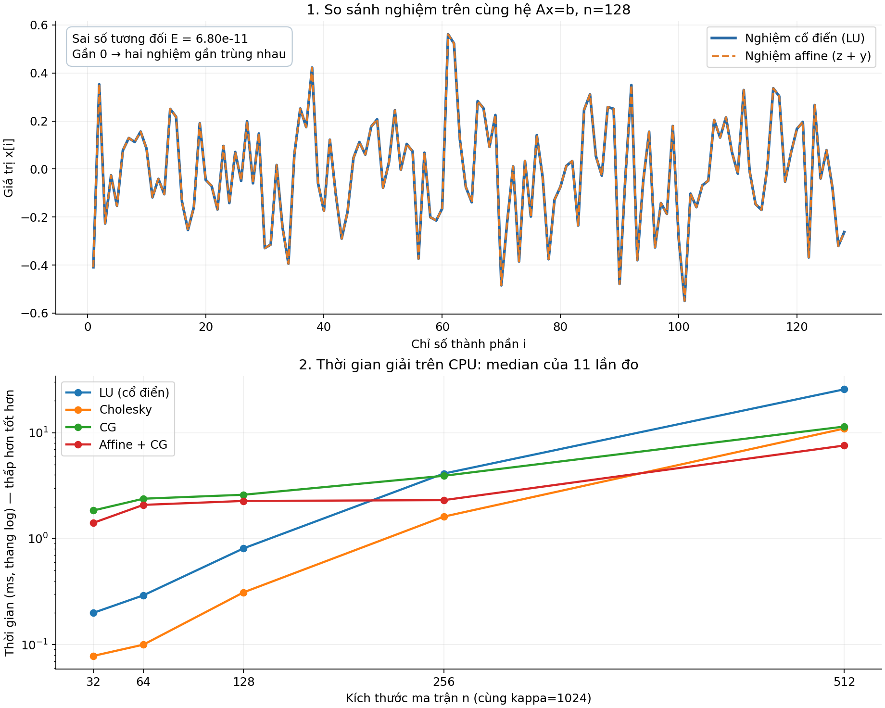

# Affine Residualization — so sánh nghiệm và thời gian giải

Mô hình Python nhỏ để kiểm chứng ý tưởng **affine residualization** trên hệ phương trình tuyến tính `Ax = b`. Dự án chỉ trả lời hai câu hỏi:

1. **Nghiệm có giống nhau không?** So sánh nghiệm LU cổ điển với nghiệm affine + CG bằng sai số tương đối chuẩn L2.
2. **Cách nào chạy nhanh hơn trên CPU?** So sánh LU, Cholesky, CG và affine + CG bằng thời gian median, tính bằng mili giây.

Chỉ cần chạy **`main.py`**. Chương trình in kết quả ra terminal và lưu hai biểu đồ trong **một ảnh `so_sanh.png`**. Không cần notebook hoặc mã nguồn của bản triển khai đầy đủ trước đây.

Ý tưởng dựa trên bản thảo *Affine Residualization for Quantum Linear Systems: Inverting Only the Unexplained Complement* của Trung Hoa Dinh, tháng 7/2026. Mô hình này tập trung vào phép tách nghiệm được mô tả trong tài liệu.

## 1. Chạy nhanh trên Windows

Cần **Python 3.10 trở lên**. Mở PowerShell trong thư mục dự án rồi chạy:

```powershell
python -m pip install -r requirements.txt
python main.py
```

Nếu muốn dùng môi trường riêng cho dự án, có thể thay bằng:

```powershell
python -m venv .venv
.\.venv\Scripts\python.exe -m pip install -r requirements.txt
.\.venv\Scripts\python.exe main.py
```

Cách này gọi trực tiếp Python trong `.venv`, không cần kích hoạt môi trường hoặc thay đổi chính sách chạy script của PowerShell.

Các thư viện cần thiết đã có trong `requirements.txt`: NumPy, SciPy, Matplotlib và threadpoolctl. Chương trình lưu ảnh trực tiếp bằng Matplotlib; không mở cửa sổ biểu đồ tương tác.

## 2. Ý tưởng affine được kiểm chứng như thế nào?

Với hệ ban đầu:

$$Ax=b,$$

nếu biết một phần nghiệm là `z`, ta viết:

$$x=z+y, \qquad r=b-Az.$$

Sau đó giải hệ phần dư:

$$Ay=r$$

và ghép lại nghiệm:

$$x_{\mathrm{affine}}=z+y.$$

Nếu giải phần dư chính xác thì `A(z + y) = Az + r = b`. Vì vậy, việc chuyển sang hệ phần dư vẫn cho nghiệm của hệ ban đầu. Điểm cần kiểm tra trong chương trình là sai số khi thực hiện bằng số thực dấu phẩy động và CG có ngưỡng dừng.

### Mô hình ma trận đang dùng

Chương trình tạo **ma trận thực, đối xứng xác định dương (SPD)** để cả bốn phương pháp đều áp dụng được:

$$A=Q\,\operatorname{diag}(\lambda_i)Q^T.$$

Trong đó:

- `Q` là ma trận trực giao ngẫu nhiên, được tạo bằng phân tích QR.
- Trị riêng nhỏ nhất là `lambda0 = 1 / KAPPA`; các trị riêng còn lại trải theo cấp số nhân từ `0.2` đến `1.0`.
- `q0 = Q[:, 0]` là vector riêng ứng với `lambda0`. Đây là hướng có trị riêng nhỏ, được gọi là **hướng khó** trong mô hình.
- `b` được sinh cùng hệ rồi chuẩn hóa để có chuẩn L2 bằng 1.
- Mỗi kích thước `n` dùng seed `SEED + n`, giúp tái lập dữ liệu khi chạy lại cùng cấu hình.

Mô hình giả định **biết sẵn `q0` và `lambda0`**. Từ đó xây dựng phần nghiệm đã biết:

$$z=q_0\frac{q_0^Tb}{\lambda_0}.$$

Sau khi lấy đi thành phần này, CG giải phần dư `r = b - Az`. Trong số học chính xác, phần dư không còn thành phần theo `q0`; đây là lý do mô hình có thể giúp CG hội tụ nhanh hơn.

**Không dùng nghiệm LU để xây dựng `z` hoặc `y`.** Các bộ giải chỉ nhận `A`, `b` và, riêng affine, cặp riêng biết sẵn `q0`, `lambda0`. Nghiệm dùng khi sinh dữ liệu không được truyền cho bộ giải; LU chỉ được dùng làm nghiệm tham chiếu để đánh giá kết quả.

## 3. So sánh thứ nhất: hai nghiệm có giống nhau không?

Trên cùng một hệ kích thước `n = 128`, chương trình tính:

- `x_LU`: giải trực tiếp `Ax = b` bằng LU.
- `x_affine`: tính `z`, giải `Ay = b - Az` bằng CG, rồi trả về `z + y`.

Metric chính là **sai số tương đối chuẩn L2**:

$$E=\frac{\|x_{\mathrm{affine}}-x_{\mathrm{LU}}\|_2}{\|x_{\mathrm{LU}}\|_2}.$$

**`E` càng gần 0, hai nghiệm càng trùng nhau.** Đây là sai số giữa hai vector nghiệm, khác với residual `||Ax - b||` dùng để dừng CG.

Ví dụ một lần chạy với cấu hình mặc định cho `E ≈ 6.804935e-11`, tức chênh lệch tương đối khoảng `0.0000000068%`. Giá trị có thể thay đổi nhẹ theo phiên bản thư viện và phép tính số trên từng máy.

Terminal in metric này cùng 10 thành phần đầu của hai nghiệm. Biểu đồ phía trên trong ảnh vẽ **toàn bộ 128 thành phần**: đường LU và đường affine gần như chồng lên nhau nếu kết quả khớp.

## 4. So sánh thứ hai: phương pháp nào nhanh hơn trên CPU?

Chương trình đo các hệ có kích thước `n = 32, 64, 128, 256, 512`, cùng `KAPPA = 1024`.

| Phương pháp | Thao tác được đo |
| --- | --- |
| LU (cổ điển) | Phân tích LU và giải hệ bằng bộ giải tổng quát của SciPy. |
| Cholesky | Phân tích Cholesky và giải hệ, tận dụng tính SPD của ma trận. |
| CG | Giải trực tiếp `Ax = b` bằng Conjugate Gradient. |
| Affine + CG | Tạo `z`, tính `r = b - Az`, giải `Ay = r` bằng CG và cộng `z + y`. |

Metric là **thời gian median của 11 lần đo**, đơn vị **ms**. Thời gian càng thấp thì phương pháp càng nhanh trong thí nghiệm này. Median là giá trị ở giữa khi sắp xếp các lần đo, giúp giảm ảnh hưởng của một vài lần chạy bất thường.

### Cách đo và kiểm tra

- Các phương pháp giải cùng `A` và `b` tại mỗi kích thước. Thời gian tạo dữ liệu không nằm trong timer của phương pháp nào.
- LU và Cholesky **phân tích lại ma trận trong từng lần đo**; không tái sử dụng phân tích từ lần trước. Thí nghiệm vì vậy đo một lần giải từ đầu, chưa đánh giá trường hợp nhiều vế phải dùng chung một ma trận.
- Mỗi phương pháp được chạy một lần khởi động trước khi đo. Trong từng lượt đo, thứ tự các phương pháp được xáo trộn với seed cố định để giảm thiên lệch theo thứ tự chạy.
- `threadpoolctl` giới hạn các thư viện BLAS được hỗ trợ về **một luồng** khi đo. Nếu thiếu thư viện này, chương trình vẫn chạy nhưng không áp dụng được giới hạn; hãy cài đủ `requirements.txt` để dùng cấu hình đo dự kiến.
- CG trực tiếp và CG trong affine cùng dùng **ngưỡng residual tuyệt đối `TOL * ||b||₂`**, tính từ vế phải **ban đầu**. Với mặc định, ngưỡng là `1e-10 * ||b||₂`; `rtol = 0` và số vòng lặp tối đa là `10 * n`.
- Nếu CG báo chưa hội tụ, chương trình dừng bằng lỗi. Sau **mỗi lần giải được đo**, chương trình còn kiểm tra sai số tương đối so với LU và dừng nếu sai số lớn hơn `1e-7`. Phần kiểm tra này nằm ngoài timer.

**Chi phí tìm `q0` không được đo**, vì mô hình giả định cấu trúc này đã biết sẵn. Nếu một bài toán thực cần tìm vector riêng trước, cần cộng thêm chi phí đó khi đánh giá tổng thời gian.

Terminal in một bảng thời gian cho bốn phương pháp. Biểu đồ phía dưới thể hiện thời gian theo kích thước ma trận; trục thời gian dùng **thang log**, nên hãy đọc giá trị trên trục thay vì chỉ so khoảng cách giữa các đường.

## 5. Đọc hình kết quả



- **Phần trên:** so sánh từng thành phần nghiệm, kèm sai số tương đối `E`.
- **Phần dưới:** so sánh thời gian median của LU, Cholesky, CG và affine + CG. Đường nằm thấp hơn tương ứng thời gian nhỏ hơn.

Mỗi lần chạy `main.py` sẽ cập nhật `so_sanh.png` ngay cạnh file mã nguồn. Ảnh được lưu trong Git để có thể xem trực tiếp trong README.

## 6. Thay đổi thí nghiệm

Chỉnh các hằng số ở đầu `main.py`, sau đó chạy lại chương trình:

| Hằng số | Mặc định | Ý nghĩa |
| --- | --- | --- |
| `N_SO_SANH_NGHIEM` | `128` | Kích thước hệ dùng để so sánh hai nghiệm. |
| `CAC_KICH_THUOC` | `[32, 64, 128, 256, 512]` | Các kích thước dùng đo thời gian. |
| `KAPPA` | `1024.0` | Tỷ số trị riêng lớn nhất/nhỏ nhất của mô hình khi `KAPPA >= 5`. |
| `SO_LAN_DO` | `11` | Số lần đo dùng để lấy median. |
| `TOL` | `1e-10` | Hệ số tạo ngưỡng residual tuyệt đối cho CG. |
| `SEED` | `2026` | Seed gốc; seed tạo hệ là `SEED + n`. |

Để giữ đúng mô hình phổ và cách diễn giải `KAPPA`, dùng mọi kích thước **`n >= 3`**, `SO_LAN_DO >= 1`, `TOL > 0` và **`KAPPA >= 5`**. Khi đó phổ có trị riêng lớn nhất bằng 1 và `1 / KAPPA <= 0.2`, đúng với thiết kế một trị riêng nhỏ hơn hoặc bằng phần phổ còn lại. Mã hiện chưa có kiểm tra đầu vào cho các hằng số này.

Hiện tại chương trình tạo dữ liệu bên trong mã, **chưa hỗ trợ đọc ma trận tùy ý, ma trận phức hoặc tham số dòng lệnh**. Không cần thêm cờ khi chạy `python main.py`.

## 7. Phạm vi kết luận

Thí nghiệm này kiểm chứng **tính đúng của cách tách nghiệm affine trên một mô hình CPU cụ thể**, rồi đo thời gian của bốn cách giải trên mô hình đó.

Thời gian phụ thuộc CPU, thư viện số, kích thước, phổ trị riêng và cấu trúc biết sẵn. Affine + CG có thể nhanh hơn hoặc chậm hơn các phương pháp khác trong từng cấu hình; việc hai nghiệm khớp không tự động chứng minh lợi thế tốc độ.

Đây **chưa phải mạch lượng tử hoặc phép đo trên phần cứng lượng tử**. Các số ms trong biểu đồ không phải bằng chứng về tăng tốc lượng tử. Mô hình hiện cũng chưa phản ánh chi phí tìm hướng khó khi cấu trúc này chưa biết sẵn.

## 8. Các file cần đưa lên Git

```text
Affine-Residualization/
├── .gitignore
├── README.md
├── LICENSE
├── main.py
├── requirements.txt
└── so_sanh.png
```

`.gitignore` bỏ qua môi trường ảo, cache, file tạm, notebook thử nghiệm ở gốc `/test.ipynb` và thư mục bản cũ `/_ban_day_du/`. Các file cũ vẫn có thể giữ trên máy. Ảnh **`/so_sanh.png` không bị bỏ qua**; lệnh `git add` bên dưới đưa ảnh vào Git để README hiển thị kết quả.

Sau khi kiểm tra kết quả chạy, chỉ stage sáu file cần thiết:

```powershell
git status --short
git add -- .gitignore README.md LICENSE main.py requirements.txt so_sanh.png
git status --short
```

Danh sách file được stage nên chỉ gồm sáu tên trên. Các lệnh này chỉ chuẩn bị nội dung, chưa commit hoặc push.

## Giấy phép

Dự án sử dụng **MIT License**. Xem đầy đủ trong [LICENSE](LICENSE).
